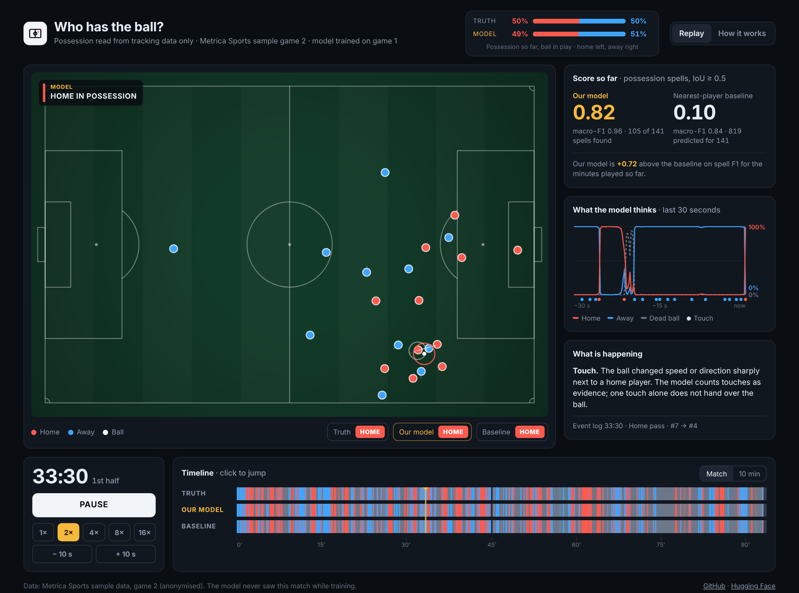

# Who has the ball?

Football possession read from tracking data alone: the positions of the 22 players and the ball, nothing else. Five times a second the model says whether the home team has the ball, the away team has it, or the ball is dead. It is scored against Metrica Sports' event log, which it never sees as an input.

**Replay:** https://huggingface.co/spaces/amreleraqi09/possession-from-tracking
**Model:** https://huggingface.co/amreleraqi09/possession-from-tracking
**From a match video, in your browser:** https://huggingface.co/spaces/amreleraqi09/possession-from-video



## Results

Trained on Metrica's sample game 1, tested on game 2, which the model never saw:

| | Spell F1 | Spells found | Spells predicted | Frame macro-F1 |
|---|---:|---:|---:|---:|
| This model | **0.817** | 257 of 347 | 282 | **0.956** |
| Same model, no smoothing | 0.761 | 271 of 347 | 365 | 0.957 |
| Nearest-player baseline | 0.100 | 114 of 347 | 1,933 | 0.849 |

The other way round (train on game 2, test on game 1) it scores 0.837 spell F1 against 0.135 for the baseline. Full numbers are in `results/metrics.json`.

A possession spell is an unbroken run of one team on the ball. A predicted spell counts as found when it overlaps a true spell of the same team with an intersection-over-union of 0.5 or more. Frame macro-F1 averages the per-frame F1 of home, away and dead ball.

The baseline gives the ball to whichever team has the player closest to it. Frame by frame it is right 86% of the time, but it changes its mind every time two players are level with the ball. It predicts 1,933 spells where there were 347 and gets very few of them whole. Closing that gap is what this project is about.

## How it works

**The answer key** (`possession/labels.py`) comes from the event log. A team gets the ball at every pass, shot, recovery, lost ball or set piece it is credited with, and keeps it until the other team's next one or until the ball goes dead. The ball goes dead when it crosses a line, when the referee stops play for a foul or an offside that leads to a set piece, and at the end of each half. Metrica stops tracking the ball when it is out of play, so a stretch of more than five seconds with no ball and no logged action is treated as a stoppage the log missed, usually an injury.

**Features** (`possession/features.py`): 78 per frame, all from positions. How far the nearest home and away players are from the ball, and how that gap moved over the previous and next few seconds. Ball speed, and the sharp changes in its velocity that mark a touch, with the team that was closest at each touch. Whether the ball is tracked at all or sits outside the lines. How fast the players are moving, and the shape of each team. This is an offline labeller, so the windows look a few seconds ahead as well as back.

**Classifier** (`possession/model.py`): LightGBM with three classes, run on every fifth frame (5 Hz).

**Smoothing** (`possession/smoothing.py`): a three-state hidden Markov model decodes the most likely sequence from the classifier's probabilities. It has two settings, how sticky possession is and how far to trust the classifier, and both were tuned on out-of-fold predictions from game 1 only.

**Scoring** (`possession/metrics.py`): frame macro-F1 and spell F1 as described above.

## Run it

```bash
git clone https://github.com/amr7772/possession-from-tracking
cd possession-from-tracking
pip install -r requirements.txt
python -m possession.pipeline
```

The pipeline downloads the two sample games (about 130 MB) into `data/raw/`, trains, tests in both directions and writes:

- `models/possession_lgbm.txt` and `models/config.json`
- `results/metrics.json`, `results/predictions_game2.csv`, `results/feature_importance.csv`
- `web/index.html`, the replay, as a single file you can open in a browser

It takes about three minutes on a laptop. `python -m pytest` runs the tests.

To label a match with the saved model:

```python
from possession.data import load_game
from possession.features import compute_features
from possession.model import load

booster, smoother, config = load("models")
match = load_game(2, "data/raw")
feats, _ = compute_features(match)
rows = feats.iloc[::config["sample_every_n_frames"]]
proba = booster.predict(rows[config["features"]])
labels = smoother.decode(proba, rows["period"].to_numpy())  # 0 home, 1 away, 2 dead
```

Other tracking sources work too, as long as you load them into the same `Match` structure: positions in metres with the origin on the centre spot, 25 frames a second.

`hf/` holds the Hugging Face model card and the Space readme.

## From a match video

No tracking data? possession/video.py works from the match video itself. Five times a second it finds the players and the ball in the picture, splits the players into two teams by shirt colour, hands the moment to the team whose nearest player is closest to the ball, and smooths the sequence with the same hidden Markov model as above. The transition matrix comes from models/config.json, so it already knows how often possession changes hands at 5 Hz.

The quickest way to try it is [the browser version](https://huggingface.co/spaces/amreleraqi09/possession-from-video): pick a video and the same steps run inside your browser, so nothing is installed and the video never leaves your computer. It is fastest with WebGPU (a recent Chrome or Edge); start with a few minutes of video. The page is hf/video-space/index.html, and the detector it downloads is in models/detector/.

For long videos, use the Colab notebook, on Google's free GPU: [open it in Colab](https://colab.research.google.com/github/amr7772/possession-from-tracking/blob/main/notebooks/video_possession.ipynb), upload a video and run the cells in order.

On your own machine:

    pip install -r requirements-video.txt
    python -m possession.video match.mp4 --teams "Zamalek=white,Al Ahly=red"

--teams names each team with its shirt colour: a word such as white, red or navy, or a hex code, close enough to tell the two kits apart. Without it the teams are named after their shirts. The run writes into out/match/:

- possession.csv: who had the ball, five times a second
- report.html: the possession split, a timeline of every spell and the numbers
- annotated.mp4: the video with each player's team and the ball marked
- summary.json, and detections.npz, which a second run reuses, so renaming the teams does not mean detecting everything again

Without a GPU, use --model yolo26s.pt. On a two-core CPU it took a little under a second per analysed frame, so a full match takes hours; try --duration 120 first.

This part has not been scored against an event log yet, so its numbers are a first estimate, not a result. Distances are measured in the picture rather than on the pitch, so a ball passing in front of a player can count as near him. Goalkeepers and referees are never given the ball; while a keeper holds it, possession stays with the last team seen on it. Replays count as live play unless the grass leaves the picture.

## Limits

- Two matches from one provider, both anonymised. Nothing here shows how the model does in another league or with another tracking system.
- The answer key inherits the event log's timing, which can be a few frames off.
- Dead balls are the easy half of the problem, because Metrica stops tracking the ball when play stops. Broadcast tracking such as SkillCorner's has no such giveaway.

What I would try next: add Metrica's third sample game (EPTS format, readable with [kloppy](https://github.com/PySport/kloppy)) to training, replace the hand-made features with a sequence model over raw positions, and test on broadcast tracking.

## Data

[Metrica Sports sample data](https://github.com/metrica-sports/sample-data). Metrica asks that public uses credit the source. The replay embeds down-sampled positions from game 2 with that credit; the raw files are not in this repository and the pipeline downloads them.

## License

The code is MIT licensed. The data belongs to Metrica Sports. The video detector, YOLO26 by Ultralytics, is licensed under AGPL-3.0, and so is its ONNX export in models/detector/.

---

### بالعربي

يحدد هذا المشروع أيّ الفريقين يستحوذ على الكرة في مباراة كرة قدم، لحظةً بلحظة، اعتمادًا على بيانات التتبّع وحدها: مواقع اللاعبين والكرة، من دون سجل الأحداث. درّبتُ النموذج على مباراة واختبرته على مباراة أخرى لم يرها، فالتقط 257 فترة استحواذ من أصل 347، مقابل 114 فقط لأبسط طريقة ممكنة، وهي منح الكرة للفريق صاحب أقرب لاعب إليها. وتعرض صفحة الإعادة الملعب وقرار النموذج إلى جانب الحقيقة وإلى جانب تلك الطريقة البسيطة.

ويعمل المشروع أيضًا من فيديو المباراة نفسه، بلا بيانات تتبّع: يجد اللاعبين والكرة في الصورة خمس مرات في الثانية، ويقسم اللاعبين إلى فريقين بحسب لون القميص، وينسب كل لحظة إلى الفريق صاحب أقرب لاعب إلى الكرة، ثم ينعّم النتيجة بنموذج ماركوف نفسه. أسهل طريقة لتجربته [صفحة على Hugging Face](https://huggingface.co/spaces/amreleraqi09/possession-from-video) تحلّل الفيديو داخل المتصفح نفسه، فلا يُرفع الفيديو إلى أي خادم، وللفيديوهات الطويلة دفتر Colab في مجلد notebooks. لم يُقَس هذا الجزء بعد على سجل أحداث، فأرقامه تقدير أولي.
